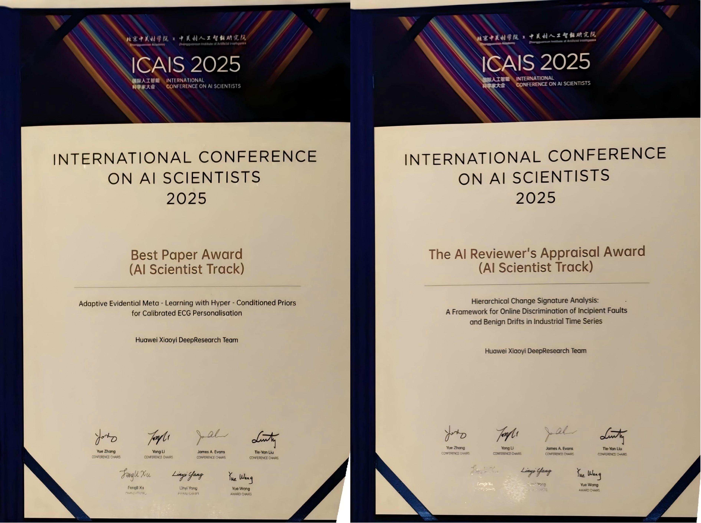
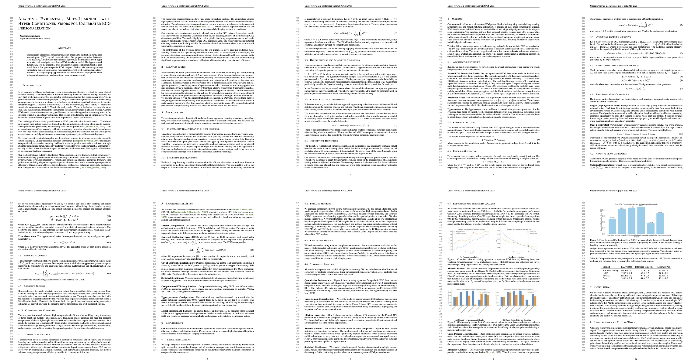
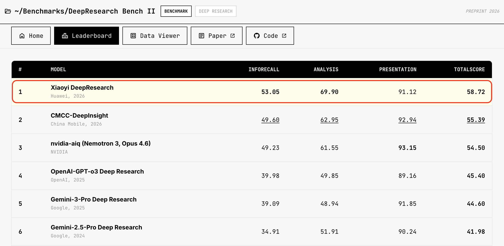
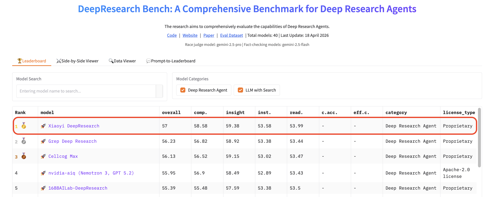
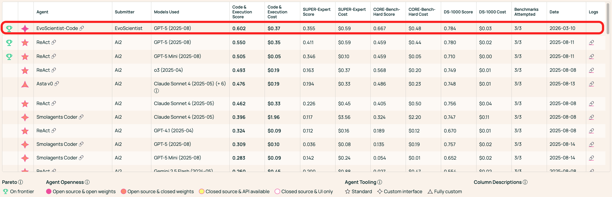
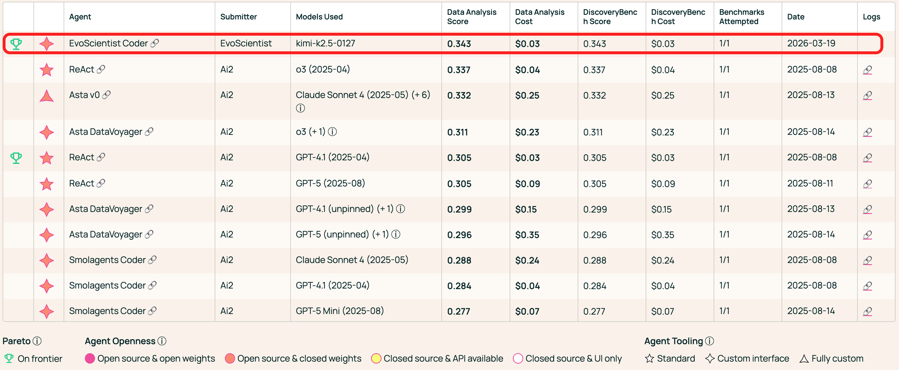
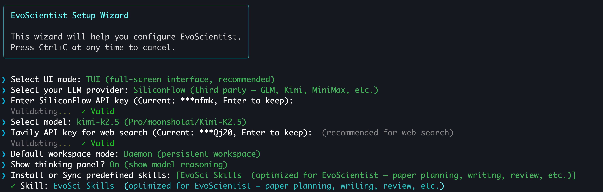
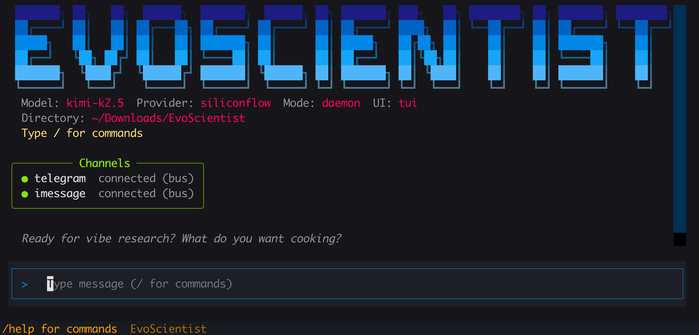

<div align="center">
    <picture>
      <source media="(prefers-color-scheme: light)" srcset="https://raw.githubusercontent.com/EvoScientist/EvoScientist/main/.github/assets/logo-dark.svg">
      <source media="(prefers-color-scheme: dark)" srcset="https://raw.githubusercontent.com/EvoScientist/EvoScientist/main/.github/assets/logo-light.svg">
      
    </picture>
</div>

<div align="center">
<a href="https://pypi.org/project/EvoScientist/"><picture>
  <source media="(prefers-color-scheme: light)" srcset="https://raw.githubusercontent.com/EvoScientist/EvoScientist/main/.github/assets/badge-pypi-light.svg">
  <source media="(prefers-color-scheme: dark)" srcset="https://raw.githubusercontent.com/EvoScientist/EvoScientist/main/.github/assets/badge-pypi-dark.svg">
  
</picture></a><a href="https://EvoScientist.github.io/"><picture>
  <source media="(prefers-color-scheme: light)" srcset="https://raw.githubusercontent.com/EvoScientist/EvoScientist/main/.github/assets/badge-website-light.svg">
  <source media="(prefers-color-scheme: dark)" srcset="https://raw.githubusercontent.com/EvoScientist/EvoScientist/main/.github/assets/badge-website-dark.svg">
  
</picture></a><a href="https://github.com/langchain-ai/deepagents"><picture>
  <source media="(prefers-color-scheme: light)" srcset="https://raw.githubusercontent.com/EvoScientist/EvoScientist/main/.github/assets/badge-framework-light.svg">
  <source media="(prefers-color-scheme: dark)" srcset="https://raw.githubusercontent.com/EvoScientist/EvoScientist/main/.github/assets/badge-framework-dark.svg">
  
</picture></a><a href="https://github.com/EvoScientist/EvoScientist/blob/main/LICENSE"><picture>
  <source media="(prefers-color-scheme: light)" srcset="https://raw.githubusercontent.com/EvoScientist/EvoScientist/main/.github/assets/badge-license-light.svg">
  <source media="(prefers-color-scheme: dark)" srcset="https://raw.githubusercontent.com/EvoScientist/EvoScientist/main/.github/assets/badge-license-dark.svg">
  
</picture></a>
</div>

---

<div align="center">
<a href="https://github.com/EvoScientist/EvoScientist"></a>
</div>

<div align="center">

**English | [简体中文](./README.zh-CN.md)**

</div>

**EvoScientist is an open-source, self-evolving AI research buddy.** Give it a research problem and it plans experiments, searches literature, writes and debugs code, analyzes data, drafts reports, and improves across sessions through persistent memory and reusable skills. Instead of babysitting every step, you stay *human-on-the-loop*—steering direction, approving sensitive actions, and grading results against your goals.

<h3>🏆 Awards & Recognition</h3>

<table>
  <tr>
      <td align="center" valign="top" width="33%">
      
      <br />
      <sub><b>Best Paper & Appraisal Award</b></sub>
    </td>
    <td align="center" valign="top" width="33%">
      
      <br />
      <sub><b>AI-Generated Best Paper</b></sub>
    </td>
    <td align="center" valign="top" width="33%">
      
      <br />
      <sub><b>#1 on DeepResearch Bench II</b></sub>
    </td>
  </tr>
</table>

<br />

<table>
  <tr>
    <td align="center" valign="top" width="33%">
      
      <br />
      <sub><b>#1 on DeepResearch Bench</b></sub>
    </td>
    <td align="center" valign="top" width="33%">
      
      <br />
      <sub><b>#1 on AstaBench Code & Execution</b></sub>
    </td>
    <td align="center" valign="top" width="33%">
      
      <br />
      <sub><b>#1 on AstaBench Data Analysis</b></sub>
    </td>
  </tr>
</table>

<h3>⚡ One Agent, Every Surface</h3>

<table>
  <tr>
    <th><p align="center">🌐 Desktop & WebUI</p></th>
  </tr>
  <tr>
    <td align="center">
      <video src="https://github.com/user-attachments/assets/b977f2d5-488a-428d-9c02-b6b27c1521f8" autoplay loop muted playsinline width="100%">
        <a href="https://github.com/user-attachments/assets/b977f2d5-488a-428d-9c02-b6b27c1521f8">View WebUI demo</a>
      </video>
    </td>
  </tr>
</table>

<table>
  <tr>
    <th width="75%"><p align="center">🖥️ CLI / TUI</p></th>
    <th width="25%"><p align="center">📱 Mobile & Messaging</p></th>
  </tr>
  <tr>
    <td align="center">
      <video src="https://github.com/user-attachments/assets/a40ba429-bb07-4663-b5b1-77aed1a833b9" autoplay loop muted playsinline width="100%">
        <a href="https://github.com/user-attachments/assets/a40ba429-bb07-4663-b5b1-77aed1a833b9">View demo video</a>
      </video>
    </td>
    <td align="center">
      <video src="https://github.com/user-attachments/assets/4919e6f4-e434-46c9-98c7-35d7482868a6" width="100%" autoplay loop muted playsinline>
        <a href="https://github.com/user-attachments/assets/4919e6f4-e434-46c9-98c7-35d7482868a6">View mobile demo</a>
      </video>
    </td>
  </tr>
</table>

## ✨ Highlights

- **Multi-Agent Research Team:** 6 built-in specialists (`planner`, `research`, `code`, `debug`, `data-analysis`, `writing`) plus installable expert skills (`/expert`).
- **Self-Evolving Memory & AutoSkills:** Automatically distills lessons from each session into a linked knowledge graph and proposes reusable skills for your review (`/autoskills`).
- **Goals & Rubrics:** Set acceptance criteria with `/goal` or `--rubric` so a separate grader verifies outputs and drives revisions automatically.
- **Every Surface, One Backend:** Desktop app, browser WebUI (`--ui webui`), Textual TUI, classic CLI, 10 messaging channels (`EvoSci serve`), cron schedules (`/schedule`), and headless `stream-json`.
- **Any Provider or Subscription:** Anthropic, OpenAI, Google, OpenRouter, DeepSeek, MiniMax, NVIDIA, Ollama, custom OpenAI/Anthropic endpoints, plus Claude Pro/Max & ChatGPT Plus/Pro OAuth sign-in.
- **Extensible via MCP & Skills:** Add MCP servers in one command (`EvoSci mcp add`) or install ready-made research workflows from [**EvoSkills**](https://github.com/EvoScientist/EvoSkills) (`/evoskills`).

## 🔥 News

- **[14 Nov 2026]** 🍎 **macOS Desktop App** (Apple silicon, signed & notarized): [**Download**](https://github.com/EvoScientist/EvoScientist-WebUI/releases/latest/download/EvoScientist-arm64.dmg)
- **[03 Nov 2026]** 🖥️ **Windows Desktop App** is out: [**Download**](https://github.com/EvoScientist/EvoScientist-WebUI/releases/latest/download/EvoScientist-Setup.exe)
- **[03 Jun 2026]** 🥈 #2 overall (#1 among `GPT-5.4` agents) on [ResearchClawBench](https://internscience.github.io/ResearchClawBench-Home/)
- **[13–18 Apr 2026]** 🥇 #1 on [DeepResearch Bench](https://huggingface.co/spaces/muset-ai/DeepResearch-Bench-Leaderboard) and [DeepResearch Bench II](https://agentresearchlab.com/benchmarks/deepresearch-bench-ii/index.html#leaderboard)
- **[25–26 Mar 2026]** 🥇 #1 on [AstaBench Code & Execution](https://allenai-asta-bench-leaderboard.hf.space/code-execution) and [Data Analysis](https://allenai-asta-bench-leaderboard.hf.space/data-analysis)
- **[11–13 Mar 2026]** 🚀 EvoScientist debuts alongside our [Technical Report](https://arxiv.org/abs/2603.08127)
- **[24 Nov 2025]** 🏆 6/6 papers accepted at [ICAIS 2025](https://icais.ai/) — Best Paper & AI Reviewer's Appraisal Award

<details>
<summary>📦 Recent Releases (v0.4.x) — see <a href="https://github.com/EvoScientist/EvoScientist/releases">GitHub Releases</a> for full history</summary>

- **[v0.4.4](https://github.com/EvoScientist/EvoScientist/releases/tag/v0.4.4)** (20 Nov 2026) — GPT-6.2 Sol/Astra, Gemini 4 Neon, HY4 Flash, Qwen 4 Max; standalone `EvoSci login chatgpt`; custom OpenAI `/models` auto-discovery; stricter shell sandbox; `deepagents 0.7.41`.
- **[v0.4.3](https://github.com/EvoScientist/EvoScientist/releases/tag/v0.4.3)** (14 Nov 2026) — Claude Fable 5.2, Gemini 4 Carbon/Hydrogen; `EvoSci workspace move`; unified `EvoSci server` (now manages `ccproxy` too); agent media files sent to chat.
- **[v0.4.2](https://github.com/EvoScientist/EvoScientist/releases/tag/v0.4.2)** (06 Nov 2026) — Unified `reasoning_effort` (default `high`) across Claude/OpenAI/OpenRouter/DeepSeek; Tencent HY4; clearer failed-command and background-process reporting.
- **[v0.4.1](https://github.com/EvoScientist/EvoScientist/releases/tag/v0.4.1)** (03 Nov 2026) — Shared background server across WebUI and Desktop app (WebUI 0.5); cancelling a server run stops its shell command; cleaner tool errors.
- **[v0.4.0](https://github.com/EvoScientist/EvoScientist/releases/tag/v0.4.0)** (31 Oct 2026) — One shared background service across projects (`EvoSci server stop`); GPT-6.1 Terra; hardened shell sandbox and safer `EvoSci update`; Apple silicon macOS.

</details>

---

## 📦 Installation

### Desktop App

<p align="center">
<a href="https://github.com/EvoScientist/EvoScientist-WebUI/releases/latest/download/EvoScientist-Setup.exe"><picture>
  <source media="(prefers-color-scheme: light)" srcset="https://raw.githubusercontent.com/EvoScientist/EvoScientist/main/.github/assets/button-download-windows-light.svg">
  <source media="(prefers-color-scheme: dark)" srcset="https://raw.githubusercontent.com/EvoScientist/EvoScientist/main/.github/assets/button-download-windows-dark.svg">
  
</picture></a>&nbsp;<a href="https://github.com/EvoScientist/EvoScientist-WebUI/releases/latest/download/EvoScientist-arm64.dmg"><picture>
  <source media="(prefers-color-scheme: light)" srcset="https://raw.githubusercontent.com/EvoScientist/EvoScientist/main/.github/assets/button-download-macos-light.svg">
  <source media="(prefers-color-scheme: dark)" srcset="https://raw.githubusercontent.com/EvoScientist/EvoScientist/main/.github/assets/button-download-macos-dark.svg">
  
</picture></a>
</p>

> [!NOTE]
> macOS requires Apple silicon on macOS 13+ (signed & notarized). The Windows installer is unsigned for now—click **More info → Run anyway** on SmartScreen.

### One-Line CLI Install *(Recommended)*

Works on a clean machine—no Python, `uv`, Node.js, or Git needed (supports macOS Apple silicon, Linux, WSL2, and native Windows with Git Bash):

```bash
# macOS / Linux / WSL2
curl -fsSL https://evoscientist.ai/install.sh | bash
```

```powershell
# Windows (PowerShell)
irm https://evoscientist.ai/install.ps1 | iex
```

Open a new terminal, run `EvoSci onboard`, then launch `EvoSci`. Update anytime with `EvoSci update`.

For mainland China mirrors (`--cn`), proxies, corporate TLS certs, and clean uninstall instructions, see the **[Installation Guide](docs/guides/install.md)**.

<details>
<summary>Other install methods (<code>uv</code>, <code>pip</code>, Docker, from source)</summary>

**`uv` or `pip` (Python 3.11–3.13):**
```bash
uv tool install EvoScientist                       # isolated CLI tool
uv pip install 'EvoScientist[telegram,slack]'      # optional channel extras (or all-channels)
uv pip install git+https://github.com/EvoScientist/EvoScientist.git  # latest main
```

**From source (contributors):**
```bash
git clone https://github.com/EvoScientist/EvoScientist.git && cd EvoScientist
uv sync --dev --extra all-channels
uv run pre-commit install
```

**Docker (sandboxes shell commands to mounted volumes):**
```bash
mkdir -p workspace   # create first on Linux so Docker doesn't make it root-owned
docker run -it --rm \
  --env-file .env \
  -v "$(pwd)/workspace:/workspace" \
  -v evosci-data:/home/evosci/.evoscientist \
  ghcr.io/evoscientist/evoscientist:latest
```
*(Run `docker run --rm -v evosci-data:/home/evosci/.evoscientist ghcr.io/evoscientist/evoscientist:latest setup` once to install the agent's research Python into the volume. A starter [`docker-compose.yml`](./docker-compose.yml) is also included: `docker compose run --rm evoscientist`. On Linux with host UID ≠ 1000, build locally with `docker build --build-arg UID="$(id -u)" -t evoscientist:local .`)*

</details>

---

## 🔑 Configuration & Quick Start

Run the interactive setup wizard once to pick your provider, model, and workspace mode (supports API keys *and* Claude/ChatGPT subscription sign-in):

```bash
EvoSci onboard
EvoSci            # launches the Textual TUI
```





### Everyday Commands

```bash
EvoSci                                        # interactive TUI (default)
EvoSci --ui webui                             # browser WebUI at http://localhost:4716
EvoSci --ui cli                               # classic CLI (easy native terminal copy)
EvoSci -p "Analyze results.csv"               # single-shot mode (or --prompt-file prompt.txt)
EvoSci --workdir /path/to/project             # open in a specific project folder
EvoSci -m run                                 # isolated per-session workspace
EvoSci serve                                  # headless mode for messaging channels
EvoSci deploy                                 # standalone LangGraph server (add --json for programmatic apps)
EvoSci -p "query" --output-format stream-json # JSONL event stream on stdout (docs/guides/stream-json.md)
EvoSci -p "query" --rubric @criteria.md       # auto-grade work against a checklist (docs/guides/rubric.md)
```

Run `EvoSci -h` for the full flag reference, or type `/help` inside a session for slash commands (`/goal`, `/rubric`, `/schedule`, `/threads`, `/resume`, `/skills`, `/evoskills`, `/expert`, `/autoskills`, `/mcp`, `/channel`, `/model`, `/compact`).

<details>
<summary>Manual API keys, project workspaces & approvals</summary>

**API keys:** Save with `EvoSci config set` (stored in `~/.config/evoscientist/config.yaml`) or export in your shell (`ANTHROPIC_API_KEY`, `OPENAI_API_KEY`, `GOOGLE_API_KEY`, `MINIMAX_API_KEY`, `NVIDIA_API_KEY`, and optional `TAVILY_API_KEY`). For vLLM, LM Studio, or gateways, see [Custom Endpoints](docs/guides/custom-endpoints.md). For Claude Pro/Max or ChatGPT Plus/Pro without API keys, see [Subscription OAuth](docs/recipes/subscription-oauth.md).

**Background server & project folders:**
- The shared background server (`EvoSci server status` / `stop`) inherits the environment of the shell that started it; restart it (`EvoSci server stop`) after changing shell exports.
- A project `.env` only configures `EvoSci` launcher flags (`EVOSCIENTIST_DEFAULT_MODE`, `EVOSCIENTIST_UI_BACKEND`)—API keys in `.env` are ignored with a warning.
- If you move or rename a project folder, migrate its sessions, memory, and schedules with `EvoSci workspace move <old_dir> <new_dir>`.

**Approvals & safety:**
- Shell commands require confirmation by default. Skip prompts with `--auto-approve`, allow safe prefixes with `EvoSci config set shell_allow_list "python,pip,pytest,ruff,git"`, or press `3` at any prompt to approve for the session.
- **Dangerous mode** (`--dangerous` or `EvoSci config set dangerous_mode true`) disables all prompts and lifts the workspace sandbox—use only when you fully trust the task. See [SECURITY.md](SECURITY.md).
- Disable clarifying questions with `EvoSci config set enable_ask_user false`.

</details>

<details>
<summary>Python SDK / script usage</summary>

```python
from EvoScientist import EvoScientist_agent
from EvoScientist.utils import format_messages
from langchain_core.messages import HumanMessage

thread = {"configurable": {"thread_id": "1"}}
last_len = 0

for state in EvoScientist_agent.stream(
    {"messages": [HumanMessage(content="Hi?")]},
    config=thread,
    stream_mode="values",
):
    msgs = state["messages"]
    if len(msgs) > last_len:
        format_messages(msgs[last_len:])
        last_len = len(msgs)
```

</details>

### Opening From Another Machine

By default, the backend (port `6174`) and WebUI (port `4716`) bind to `127.0.0.1` only.

- **Safest (recommended over untrusted networks):** Keep loopback and tunnel over SSH:
  ```bash
  ssh -L 6174:localhost:6174 -L 4716:localhost:4716 <host>
  ```
- **Trusted LAN only:** Pass `--host 0.0.0.0` (or persist `webui_host` / `langgraph_dev_host`) and point the browser UI's deployment URL at `http://<machine-ip>:6174`. If accessing from another browser origin (like LangSmith Studio or a custom DNS host), allowlist it with `EvoSci config set backend_allowed_origins https://smith.langchain.com` and run `EvoSci server stop`.

> [!WARNING]
> Port `6174` is an unauthenticated API that can execute shell commands as you. Never expose it on an untrusted network or shared multi-user machine—read [SECURITY.md](SECURITY.md).

---

## ⏰ Scheduled Tasks, MCP & Channels

- **Scheduled tasks (`/schedule`):** Run recurring research on cron schedules (or just ask in natural language). Add `--rubric "<checklist>"` to grade every run automatically:
  ```text
  /schedule add "0 9 * * 1-5" "Summarize new arXiv ML papers using paper-navigator and save to /memories/daily-papers.md"
  /schedule list | pause <id> | resume <id> | run <id> | remove <id>
  ```
- **MCP servers:** Add external tools in one command — `EvoSci mcp add sequential-thinking npx -- -y @modelcontextprotocol/server-sequential-thinking` ([MCP Guide](EvoScientist/mcp/README.md)).
- **Messaging channels:** Share your agent session across Telegram, Discord, Slack, Feishu, WeChat, DingTalk, QQ, Signal, Email, and iMessage — `EvoSci channel setup telegram` ([Channels Guide](EvoScientist/channels/README.md)).

## 📚 Documentation

Browse the full documentation index in **[docs/README.md](docs/README.md)**:

- **[Installation Guide](docs/guides/install.md)** — One-line installer, `--cn` mirrors, proxies, TLS certs, `EvoSci update`, uninstall
- **[Custom Endpoints](docs/guides/custom-endpoints.md)** — vLLM, LM Studio, LiteLLM, and OpenAI/Anthropic-compatible gateways
- **[Subscription Sign-In](docs/recipes/subscription-oauth.md)** — Claude Pro/Max (`ccproxy`) and ChatGPT Plus/Pro without API keys
- **[Goals (`/goal`)](docs/guides/goal.md)** & **[Rubrics (`--rubric` / `/rubric`)](docs/guides/rubric.md)** — Self-checking acceptance criteria
- **[Model Retries](docs/guides/model-retry.md)** — Transient failure budgets and fallback chains
- **[`stream-json` Protocol](docs/guides/stream-json.md)** — Headless JSONL integration for SDKs and scripts
- **[24/7 macOS Deployment](docs/recipes/deployment-macos-24h.md)** & **[Literature Survey Example](docs/examples/survey-literature/README.md)**
- **[Security Policy](SECURITY.md)** — Trust model and vulnerability reporting

---

## 🤝 Contributing & Community

Read **[CONTRIBUTING.md](CONTRIBUTING.md)** before opening a PR (and **[AGENTS.md](AGENTS.md)** if you're using a coding agent). Niche domain workflows belong in [**EvoSkills**](https://github.com/EvoScientist/EvoSkills).


- **[Discord](https://discord.gg/AZ9ZMXkunY)** — Ask questions, share results, and coordinate with contributors.
- **[WeChat](https://github.com/EvoScientist/EvoScientist/blob/main/.github/assets/cn_info.md)** — Join our Chinese-speaking community:

  

## 🌍 Team & Acknowledgments

Built on [**LangChain**](https://github.com/langchain-ai/langchain), [**DeepAgents**](https://github.com/langchain-ai/deepagents), and [**jiuwenswarm**](https://github.com/openJiuwen-ai/jiuwenswarm).

#### Core Contributors

<table>
  <tbody>
    <tr>
      <td align="center">
        <a href="https://x-izhang.github.io/">
          
          <br />
          <sub><b>Xi Zhang</b></sub>
        </a>
      </td>
      <td align="center">
        <a href="https://youganglyu.github.io/">
          
          <br />
          <sub><b>Yougang Lyu</b></sub>
        </a>
      </td>
      <td align="center">
        <a href="https://din0s.me/">
          
          <br />
          <sub><b>Dinos Papakostas</b></sub>
        </a>
      </td>
      <td align="center">
        <a href="https://www.linkedin.com/in/qianru-meng-410311100/">
          
          <br />
          <sub><b>Qianru Meng</b></sub>
        </a>
      </td>
      <td align="center">
        <a href="https://muxincg2004.github.io/">
          
          <br />
          <sub><b>Ziheng Zhang</b></sub>
        </a>
      </td>
      <td align="center">
        <a href="https://xiaohuiyan.github.io/">
          
          <br />
          <sub><b>Xiaohui Yan</b></sub>
        </a>
      </td>
    </tr>
  </tbody>
</table>

#### Contributors

Jakub Kaliski, Jakub Filipiuk, Yuyue Zhao, Jan Piotrowski, Wiktor Cupiał, Xinhao Yi, Shuyu Guo, Andreas Sauter, Wenxiang Hu, Jacopo Urbani, Zaiqiao Meng, Jun Luo, Lun Zhou

> <a href="https://xiaoyi.huawei.com/chat/research"></a> [*Xiaoyi DeepResearch*](https://xiaoyi.huawei.com/chat/research) *Team* and the wider open-source community contribute to this project.

Contact: [**EvoScientist.ai@gmail.com**](mailto:evoscientist.ai@gmail.com)

<a href="https://github.com/EvoScientist/EvoScientist/graphs/contributors">
  
</a>

### 📈 Star History

[](https://www.star-history.com/?repos=EvoScientist%2FEvoScientist&type=date&legend=top-left)

## 📝 Citation & License

Licensed under **Apache 2.0** ([LICENSE](./LICENSE)). If EvoScientist helps your research, please cite:

```bibtex
@article{evoscientist2026,
  title={EvoScientist: Towards Multi-Agent Evolving AI Scientists for End-to-End Scientific Discovery},
  author={Yougang Lyu and Xi Zhang and Xinhao Yi and Yuyue Zhao and Shuyu Guo and Wenxiang Hu and Jan Piotrowski and Jakub Kaliski and Jacopo Urbani and Zaiqiao Meng and Lun Zhou and Xiaohui Yan},
  journal={arXiv preprint arXiv:2603.08127},
  year={2026}
}
```
