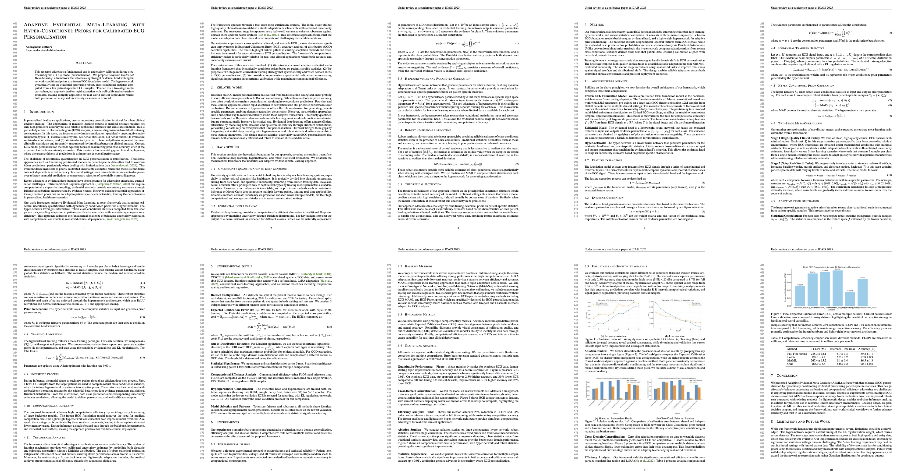
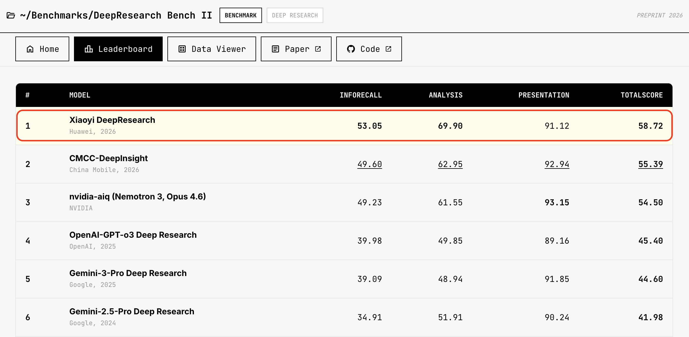
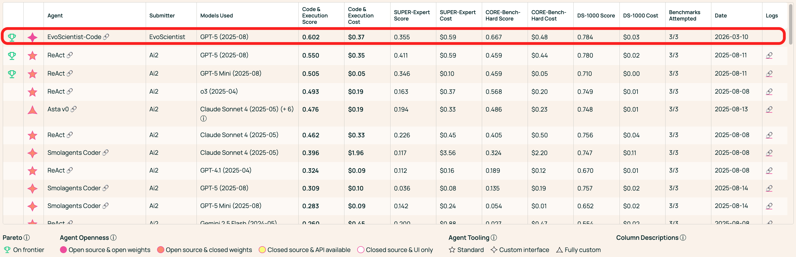
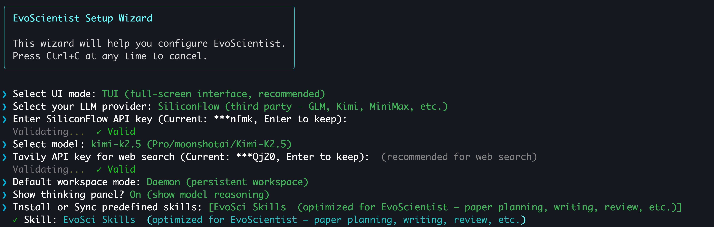
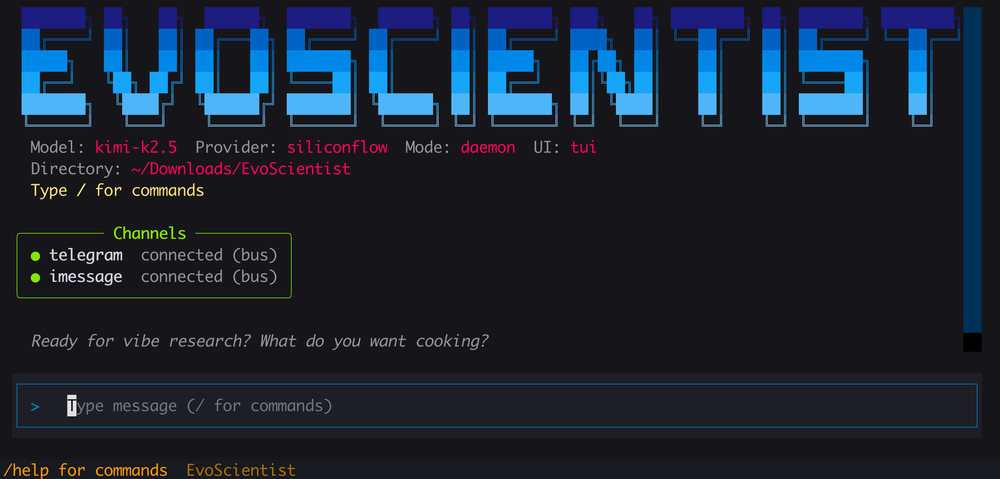

<div align="center">
    <picture>
      <source media="(prefers-color-scheme: light)" srcset="https://raw.githubusercontent.com/EvoScientist/EvoScientist/main/.github/assets/logo-dark.svg">
      <source media="(prefers-color-scheme: dark)" srcset="https://raw.githubusercontent.com/EvoScientist/EvoScientist/main/.github/assets/logo-light.svg">
      
    </picture>
</div>

<div align="center">
<a href="https://pypi.org/project/EvoScientist/"><picture>
  <source media="(prefers-color-scheme: light)" srcset="https://raw.githubusercontent.com/EvoScientist/EvoScientist/main/.github/assets/badge-pypi-light.svg">
  <source media="(prefers-color-scheme: dark)" srcset="https://raw.githubusercontent.com/EvoScientist/EvoScientist/main/.github/assets/badge-pypi-dark.svg">
  
</picture></a><a href="https://EvoScientist.github.io/"><picture>
  <source media="(prefers-color-scheme: light)" srcset="https://raw.githubusercontent.com/EvoScientist/EvoScientist/main/.github/assets/badge-website-light.svg">
  <source media="(prefers-color-scheme: dark)" srcset="https://raw.githubusercontent.com/EvoScientist/EvoScientist/main/.github/assets/badge-website-dark.svg">
  
</picture></a><a href="https://github.com/langchain-ai/deepagents"><picture>
  <source media="(prefers-color-scheme: light)" srcset="https://raw.githubusercontent.com/EvoScientist/EvoScientist/main/.github/assets/badge-framework-light.svg">
  <source media="(prefers-color-scheme: dark)" srcset="https://raw.githubusercontent.com/EvoScientist/EvoScientist/main/.github/assets/badge-framework-dark.svg">
  
</picture></a><a href="https://github.com/EvoScientist/EvoScientist/blob/main/LICENSE"><picture>
  <source media="(prefers-color-scheme: light)" srcset="https://raw.githubusercontent.com/EvoScientist/EvoScientist/main/.github/assets/badge-license-light.svg">
  <source media="(prefers-color-scheme: dark)" srcset="https://raw.githubusercontent.com/EvoScientist/EvoScientist/main/.github/assets/badge-license-dark.svg">
  
</picture></a>
</div>

---

<div align="center">
<a href="https://github.com/EvoScientist/EvoScientist"></a>
</div>

<div align="center">

**[English](./README.md) | 简体中文**

</div>

**EvoScientist 是一个开源的自我进化 AI 科研伙伴。** 只需给出研究问题，它便能自主制定实验计划、检索文献、编写与调试代码、分析数据并撰写报告，同时在跨会话记忆与技能积累中持续成长。相比步步紧盯的人在回路（Human-in-the-Loop），它采用**人在环上（Human-on-the-Loop）**模式——由你把握方向、审批关键操作，并用目标和验收标准把关结果。

<h3>🏆 荣誉与认可</h3>

<table>
  <tr>
    <td align="center" valign="top" width="33%">
      
      <br />
      <sub><b>最佳论文与评审奖</b></sub>
    </td>
    <td align="center" valign="top" width="33%">
      
      <br />
      <sub><b>AI 生成最佳论文</b></sub>
    </td>
    <td align="center" valign="top" width="33%">
      
      <br />
      <sub><b>DeepResearch Bench II 第一名</b></sub>
    </td>
  </tr>
</table>

<br />

<table>
  <tr>
    <td align="center" valign="top" width="33%">
      
      <br />
      <sub><b>DeepResearch Bench 第一名</b></sub>
    </td>
    <td align="center" valign="top" width="33%">
      
      <br />
      <sub><b>AstaBench 代码与执行榜第一名</b></sub>
    </td>
    <td align="center" valign="top" width="33%">
      
      <br />
      <sub><b>AstaBench 数据分析榜第一名</b></sub>
    </td>
  </tr>
</table>

<h3>⚡ 统一后端，多端协作</h3>

<table>
  <tr>
    <th><p align="center">🌐 桌面端与 WebUI</p></th>
  </tr>
  <tr>
    <td align="center">
      <video src="https://github.com/user-attachments/assets/b977f2d5-488a-428d-9c02-b6b27c1521f8" autoplay loop muted playsinline width="100%">
        <a href="https://github.com/user-attachments/assets/b977f2d5-488a-428d-9c02-b6b27c1521f8">观看 WebUI 演示</a>
      </video>
    </td>
  </tr>
</table>

<table>
  <tr>
    <th width="75%"><p align="center">🖥️ CLI / TUI</p></th>
    <th width="25%"><p align="center">📱 移动端与即时通讯</p></th>
  </tr>
  <tr>
    <td align="center">
      <video src="https://github.com/user-attachments/assets/a40ba429-bb07-4663-b5b1-77aed1a833b9" autoplay loop muted playsinline width="100%">
        <a href="https://github.com/user-attachments/assets/a40ba429-bb07-4663-b5b1-77aed1a833b9">观看终端演示</a>
      </video>
    </td>
    <td align="center">
      <video src="https://github.com/user-attachments/assets/4919e6f4-e434-46c9-98c7-35d7482868a6" width="100%" autoplay loop muted playsinline>
        <a href="https://github.com/user-attachments/assets/4919e6f4-e434-46c9-98c7-35d7482868a6">观看移动端演示</a>
      </video>
    </td>
  </tr>
</table>

## ✨ 核心特性

- **多智能体科研团队：** 内置规划、文献调研、编码、调试、数据分析与论文写作等专职子智能体，并支持按需调用专家技能（`/expert`）。
- **自我进化记忆与 AutoSkills：** 每轮自动提炼经验并构建关联知识图谱，定期从记忆中生成可复用技能供你审核（`/autoskills`）。
- **目标驱动与验收评分：** 用 `/goal` 或 `--rubric` 设定验收清单，由独立评审模型自动检查产物并驱动修订。
- **多端统一体验：** 支持桌面客户端、浏览器 WebUI（`--ui webui`）、Textual TUI、经典 CLI、Telegram / Slack / 飞书等即时通讯渠道（`EvoSci serve`）、定时任务（`/schedule`）以及无头 `stream-json` 流。
- **多模型与订阅直连：** 支持 Anthropic、OpenAI、Google、OpenRouter、DeepSeek、MiniMax、NVIDIA、Ollama 与自定义 OpenAI/Anthropic 接口，也支持 Claude Pro/Max 与 ChatGPT Plus/Pro 订阅登录。
- **MCP 与技能生态：** 一条命令接入 MCP 服务器（`EvoSci mcp add`），或通过 `/evoskills` 直接安装 [**EvoSkills**](https://github.com/EvoScientist/EvoSkills) 科研全流程技能。

## 🔥 动态

- **[2026-11-14]** 🍎 **macOS 桌面端**（Apple Silicon，已签名公证）发布：[**立即下载**](https://github.com/EvoScientist/EvoScientist-WebUI/releases/latest/download/EvoScientist-arm64.dmg)
- **[2026-11-03]** 🖥️ **Windows 桌面端**发布：[**立即下载**](https://github.com/EvoScientist/EvoScientist-WebUI/releases/latest/download/EvoScientist-Setup.exe)
- **[2026-06-03]** 🥈 [ResearchClawBench](https://internscience.github.io/ResearchClawBench-Home/) 总榜第二（`GPT-5.4` 阵营第一）
- **[2026-04-13–18]** 🥇 登顶 [DeepResearch Bench](https://huggingface.co/spaces/muset-ai/DeepResearch-Bench-Leaderboard) 与 [DeepResearch Bench II](https://agentresearchlab.com/benchmarks/deepresearch-bench-ii/index.html#leaderboard)
- **[2026-03-25–26]** 🥇 登顶 [AstaBench 代码与执行](https://allenai-asta-bench-leaderboard.hf.space/code-execution) 与 [数据分析](https://allenai-asta-bench-leaderboard.hf.space/data-analysis) 榜
- **[2026-03-11–13]** 🚀 EvoScientist 正式开源并发布[技术报告](https://arxiv.org/abs/2603.08127)
- **[2025-11-24]** 🏆 [ICAIS 2025](https://icais.ai/) 投稿 6/6 全中，荣获最佳论文与 AI 评审奖

完整版本更新记录请见 **[GitHub Releases](https://github.com/EvoScientist/EvoScientist/releases)**。

---

## 📦 安装

### 桌面客户端

<p align="center">
<a href="https://github.com/EvoScientist/EvoScientist-WebUI/releases/latest/download/EvoScientist-Setup.exe"><picture>
  <source media="(prefers-color-scheme: light)" srcset="https://raw.githubusercontent.com/EvoScientist/EvoScientist/main/.github/assets/button-download-windows-light.svg">
  <source media="(prefers-color-scheme: dark)" srcset="https://raw.githubusercontent.com/EvoScientist/EvoScientist/main/.github/assets/button-download-windows-dark.svg">
  
</picture></a>&nbsp;<a href="https://github.com/EvoScientist/EvoScientist-WebUI/releases/latest/download/EvoScientist-arm64.dmg"><picture>
  <source media="(prefers-color-scheme: light)" srcset="https://raw.githubusercontent.com/EvoScientist/EvoScientist/main/.github/assets/button-download-macos-light.svg">
  <source media="(prefers-color-scheme: dark)" srcset="https://raw.githubusercontent.com/EvoScientist/EvoScientist/main/.github/assets/button-download-macos-dark.svg">
  
</picture></a>
</p>

> [!NOTE]
> macOS 版仅支持 Apple Silicon（macOS 13+，已签名公证）。Windows 安装包暂未签名，遇到 SmartScreen 提示时点击**更多信息 → 仍要运行**即可。

### 一键命令行安装（推荐）

无需预先安装 Python、`uv` 或 Node.js，支持 macOS（Apple Silicon）、Linux、WSL2 与原生 Windows：

```bash
# macOS / Linux / WSL2
curl -fsSL https://evoscientist.ai/install.sh | bash

# 中国大陆镜像（--cn）
curl -fsSL https://cdn.jsdelivr.net/gh/EvoScientist/EvoScientist@main/scripts/install.sh | bash -s -- --cn
```

```powershell
# Windows (PowerShell)
irm https://evoscientist.ai/install.ps1 | iex

# 中国大陆镜像（-Cn）
& ([scriptblock]::Create((irm https://cdn.jsdelivr.net/gh/EvoScientist/EvoScientist@main/scripts/install.ps1))) -Cn
```

安装完成后**重新打开终端**，执行 `EvoSci onboard`，然后运行 `EvoSci`。后续升级只需运行 `EvoSci update`。

代理、企业 TLS 证书与完整卸载步骤见 **[安装指南](docs/guides/install.md)**。

<details>
<summary>其他安装方式（<code>uv</code> / <code>pip</code> / Docker / 源码开发）</summary>

**`uv` 或 `pip`（需 Python 3.11–3.13）：**
```bash
uv tool install EvoScientist                           # 独立 CLI 工具
uv tool install 'EvoScientist[telegram,slack]'         # 附带渠道依赖（或 all-channels）
uv tool install git+https://github.com/EvoScientist/EvoScientist.git  # 最新 main 分支
pip install EvoScientist                               # 或安装到已有虚拟环境
```
*（`EvoSci channel setup` 也会自动为所选渠道安装缺失的依赖。）*

**源码开发（贡献者）：**
```bash
git clone https://github.com/EvoScientist/EvoScientist.git && cd EvoScientist
uv sync --dev --extra all-channels
uv run EvoSci setup        # 按需安装 Node.js、智能体的 Python 环境、WebUI
uv run pre-commit install
```

**Docker（将 shell 命令沙箱限制在挂载目录内）：**
```bash
mkdir -p workspace   # Linux 下请先创建，避免 Docker 以 root 身份创建该目录
docker run --rm -v evosci-data:/home/evosci/.evoscientist ghcr.io/evoscientist/evoscientist:latest setup   # 首次运行一次
docker run -it --rm \
  --env-file .env \
  -v "$(pwd)/workspace:/workspace" \
  -v evosci-data:/home/evosci/.evoscientist \
  ghcr.io/evoscientist/evoscientist:latest
```
*（`--env-file .env` 用于设置容器的环境变量，如 API Key。`docker compose` 用法、Linux 下 UID 不是 1000 时的文件权限处理，以及如何加装 `stt`/`oauth` 依赖或 LaTeX，见[安装指南的 Docker 一节](docs/guides/install.md#docker)。）*

</details>

---

## 🔑 配置与快速开始

首次运行交互式向导，完成服务商、模型、API Key（或 Claude/ChatGPT 订阅登录）与工作区配置：

```bash
EvoSci onboard
EvoSci
```





### 常用命令

```bash
EvoSci                                        # 交互式 TUI（默认）
EvoSci --ui webui                             # 浏览器 WebUI（http://localhost:4716）
EvoSci --ui cli                               # 经典 CLI（便于终端原生复制）
EvoSci -p "分析 results.csv"                  # 单次运行（长提示可用 --prompt-file prompt.txt）
EvoSci --workdir /path/to/project             # 在指定项目目录启动
EvoSci -m run                                 # 每个会话使用独立隔离的工作区
EvoSci serve                                  # 无头模式（用于即时通讯渠道）
EvoSci deploy                                 # 独立 LangGraph 后端（程序集成可加 --json）
EvoSci -p "query" --output-format stream-json # stdout 输出 JSONL 事件流（见 docs/guides/stream-json.md）
EvoSci -p "query" --rubric @criteria.md       # 按验收清单自动评分修订（见 docs/guides/rubric.md）
```

运行 `EvoSci -h` 查看全部参数；在会话中输入 `/help` 查看斜杠命令（`/goal`、`/rubric`、`/schedule`、`/threads`、`/resume`、`/skills`、`/evoskills`、`/expert`、`/autoskills`、`/mcp`、`/channel`、`/model`、`/compact`）。

<details>
<summary>手动配置 API Key、项目工作区与审批</summary>

**API Key：** 用 `EvoSci config set` 保存（写入 `~/.config/evoscientist/config.yaml`），或在 shell 中导出（`ANTHROPIC_API_KEY`、`OPENAI_API_KEY`、`GOOGLE_API_KEY`、`MINIMAX_API_KEY`、`NVIDIA_API_KEY`，以及可选的 `TAVILY_API_KEY`；MiniMax 国际版（platform.minimax.io）的 key 还需要 `MINIMAX_BASE_URL=https://api.minimax.io/anthropic`）。vLLM、LM Studio 或网关见[自定义接口](docs/guides/custom-endpoints.md)；不用 API Key、直接使用 Claude Pro/Max 或 ChatGPT Plus/Pro 订阅见[订阅登录](docs/recipes/subscription-oauth.md)。

**后台服务与项目目录：**
- 共享后台服务（`EvoSci server status` / `stop`）继承启动它的 shell 的环境变量；修改 shell 导出的变量后，请执行 `EvoSci server stop` 让它重启。
- 项目中的 `.env` 只用于 `EvoSci` 命令自身的设置（如 `EVOSCIENTIST_DEFAULT_MODE` 或 `EVOSCIENTIST_UI_BACKEND`）。其中的 API Key 会被忽略并给出警告；其他变量（如 `HF_TOKEN`）同样会被忽略——请在启动 `EvoSci` 前在 shell 中导出。
- 移动或重命名项目目录后，用 `EvoSci workspace move <old_dir> <new_dir>` 迁移其会话、记忆与定时任务。

**审批与安全：**
- 默认情况下 shell 命令需要确认。可用 `--auto-approve` 跳过确认，用 `EvoSci config set shell_allow_list "pytest,ruff"` 让指定的命令前缀免确认运行，或在任意确认提示中对本次会话全部放行（TUI 里按 `3`、频道里回复 `3`，经典 CLI 里选 **Approve all (session)**）。
- 放行列表只匹配命令前缀，而智能体写文件无需确认。只要放行的命令能运行代码——`python`、`pip`、`git`，或对智能体自己写的测试文件运行 `pytest`——智能体就能不经确认运行任意代码，所以只放行那些你每次都会批准的命令。
- **危险模式**会跳过审批提示并解除工作区沙箱——仅在完全信任任务时使用。`--dangerous` 只作用于当前会话自己的智能体；`EvoSci config set dangerous_mode true` 会持久生效，并同样作用于后台服务与 WebUI。详见 [SECURITY.md](SECURITY.md)。
- 关闭澄清提问：`EvoSci config set enable_ask_user false`。

</details>

<details>
<summary>Python SDK / 脚本调用</summary>

```python
from EvoScientist import EvoScientist_agent
from EvoScientist.utils import format_messages
from langchain_core.messages import HumanMessage

thread = {"configurable": {"thread_id": "1"}}
last_len = 0

for state in EvoScientist_agent.stream(
    {"messages": [HumanMessage(content="Hi?")]},
    config=thread,
    stream_mode="values",
):
    msgs = state["messages"]
    if len(msgs) > last_len:
        format_messages(msgs[last_len:])
        last_len = len(msgs)
```

</details>

### 从其他设备访问

后台服务（端口 `6174`）与 WebUI（端口 `4716`）默认仅监听 `127.0.0.1`。

- **最安全（在不可信网络中推荐）：** 保持仅本机监听，通过 SSH 端口转发访问：
  ```bash
  ssh -L 6174:localhost:6174 -L 4716:localhost:4716 <host>
  ```
- **仅限可信局域网：** 传入 `--host 0.0.0.0`（或持久化设置 `webui_host` / `langgraph_dev_host`），并将浏览器端 UI 的部署地址指向 `http://<machine-ip>:6174`。如需从其他浏览器来源访问（如 LangSmith Studio 或自定义域名），用 `EvoSci config set backend_allowed_origins https://smith.langchain.com` 加入白名单。正在运行的后台服务会保留原有的监听地址与来源设置，直到你执行 `EvoSci server stop`。

> [!WARNING]
> 端口 `6174` 是一个无需认证、可以以你的身份执行 shell 命令的 API。切勿将其暴露在不可信网络或多人共用的机器上——请阅读 [SECURITY.md](SECURITY.md)。

---

## ⏰ 定时任务、MCP 与消息渠道

- **定时任务（`/schedule`）：** 按 Cron 表达式定期运行科研任务（也可直接用自然语言描述）。加上 `--rubric "<checklist>"` 可对每次运行自动验收：
  ```text
  /schedule add "0 9 * * 1-5" "Summarize new arXiv ML papers using paper-navigator and save to /memories/daily-papers.md"
  /schedule list | pause <id> | resume <id> | run <id> | remove <id>
  ```
- **MCP 工具接入：** 一行命令添加外部 MCP 服务 — `EvoSci mcp add sequential-thinking npx -- -y @modelcontextprotocol/server-sequential-thinking`（见 [MCP 指南](EvoScientist/mcp/README.md)）。
- **消息渠道：** 在 Telegram、Discord、Slack、飞书、微信（企业微信 / 公众号 / 个人微信）、钉钉、QQ、Signal、邮件和 iMessage 之间共享同一个智能体会话 — `EvoSci channel setup`（见 [渠道指南](EvoScientist/channels/README.md)）。

## 📚 完整文档

完整文档索引见 **[docs/README.md](docs/README.md)**：

- **[安装指南](docs/guides/install.md)** — 一键安装、`--cn` 镜像、Docker、代理、TLS 证书、`EvoSci update` 与卸载
- **[自定义接口](docs/guides/custom-endpoints.md)** — vLLM、LM Studio、LiteLLM 以及兼容 OpenAI/Anthropic 的网关
- **[订阅登录](docs/recipes/subscription-oauth.md)** — 无需 API Key，使用 Claude Pro/Max（`ccproxy`）与 ChatGPT Plus/Pro
- **[目标（`/goal`）](docs/guides/goal.md)** 与 **[验收清单（`--rubric` / `/rubric`）](docs/guides/rubric.md)** — 自动检查的验收标准
- **[模型重试](docs/guides/model-retry.md)** — 临时故障的重试预算与备用模型链
- **[`stream-json` 协议](docs/guides/stream-json.md)** — 面向 SDK 与脚本的无头 JSONL 集成
- **[macOS 7×24 小时部署](docs/recipes/deployment-macos-24h.md)** 与 **[文献综述示例](docs/examples/survey-literature/README.md)**
- **[安全策略](SECURITY.md)** — 信任模型与漏洞报告

---

## 🤝 参与贡献与社区

提 PR 前请先阅读 **[CONTRIBUTING.md](CONTRIBUTING.md)**（使用 AI 编程助手请先阅读 **[AGENTS.md](AGENTS.md)**）。垂直科研工作流推荐贡献到 [**EvoSkills**](https://github.com/EvoScientist/EvoSkills)。


- **[Discord](https://discord.gg/AZ9ZMXkunY)** — 实时交流、问题反馈与协作开发。
- **[微信交流群](https://github.com/EvoScientist/EvoScientist/blob/main/.github/assets/cn_info.md)** — 加入中文科研社区：

  

## 🌍 团队与致谢

本项目基于 [**LangChain**](https://github.com/langchain-ai/langchain)、[**DeepAgents**](https://github.com/langchain-ai/deepagents) 与 [**jiuwenswarm**](https://github.com/openJiuwen-ai/jiuwenswarm) 构建。

#### 核心贡献者

<table>
  <tbody>
    <tr>
      <td align="center">
        <a href="https://x-izhang.github.io/">
          
          <br />
          <sub><b>Xi Zhang</b></sub>
        </a>
      </td>
      <td align="center">
        <a href="https://youganglyu.github.io/">
          
          <br />
          <sub><b>Yougang Lyu</b></sub>
        </a>
      </td>
      <td align="center">
        <a href="https://din0s.me/">
          
          <br />
          <sub><b>Dinos Papakostas</b></sub>
        </a>
      </td>
      <td align="center">
        <a href="https://www.linkedin.com/in/qianru-meng-410311100/">
          
          <br />
          <sub><b>Qianru Meng</b></sub>
        </a>
      </td>
      <td align="center">
        <a href="https://muxincg2004.github.io/">
          
          <br />
          <sub><b>Ziheng Zhang</b></sub>
        </a>
      </td>
      <td align="center">
        <a href="https://xiaohuiyan.github.io/">
          
          <br />
          <sub><b>Xiaohui Yan</b></sub>
        </a>
      </td>
    </tr>
  </tbody>
</table>

#### 贡献者

Jakub Kaliski, Jakub Filipiuk, Yuyue Zhao, Jan Piotrowski, Wiktor Cupiał, Xinhao Yi, Shuyu Guo, Andreas Sauter, Wenxiang Hu, Jacopo Urbani, Zaiqiao Meng, Jun Luo, Lun Zhou

> 感谢 <a href="https://xiaoyi.huawei.com/chat/research"></a> [*小艺深度研究（Xiaoyi DeepResearch）*](https://xiaoyi.huawei.com/chat/research) 团队与广大开源社区的贡献。

联系我们：[**EvoScientist.ai@gmail.com**](mailto:evoscientist.ai@gmail.com)

<a href="https://github.com/EvoScientist/EvoScientist/graphs/contributors">
  
</a>

### 📈 Star 趋势

[](https://www.star-history.com/?repos=EvoScientist%2FEvoScientist&type=date&legend=top-left)

## 📝 引用与许可证

采用 **Apache 2.0** 协议开源（[LICENSE](./LICENSE)）。如果本项目对你的研究有帮助，欢迎引用：

```bibtex
@article{evoscientist2026,
  title={EvoScientist: Towards Multi-Agent Evolving AI Scientists for End-to-End Scientific Discovery},
  author={Yougang Lyu and Xi Zhang and Xinhao Yi and Yuyue Zhao and Shuyu Guo and Wenxiang Hu and Jan Piotrowski and Jakub Kaliski and Jacopo Urbani and Zaiqiao Meng and Lun Zhou and Xiaohui Yan},
  journal={arXiv preprint arXiv:2603.08127},
  year={2026}
}
```
