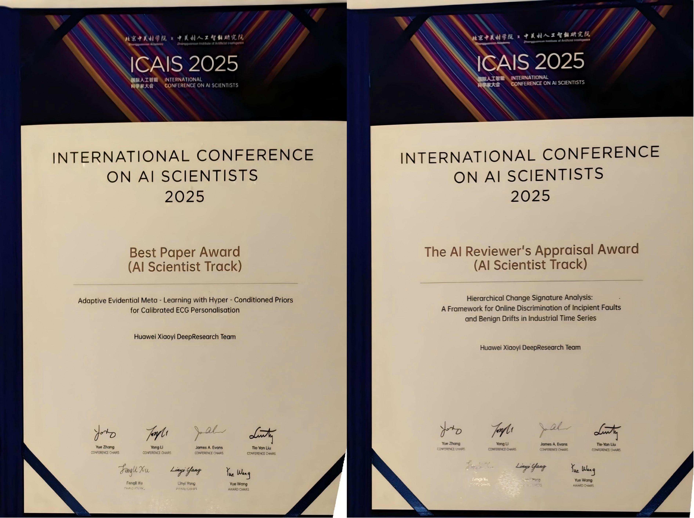
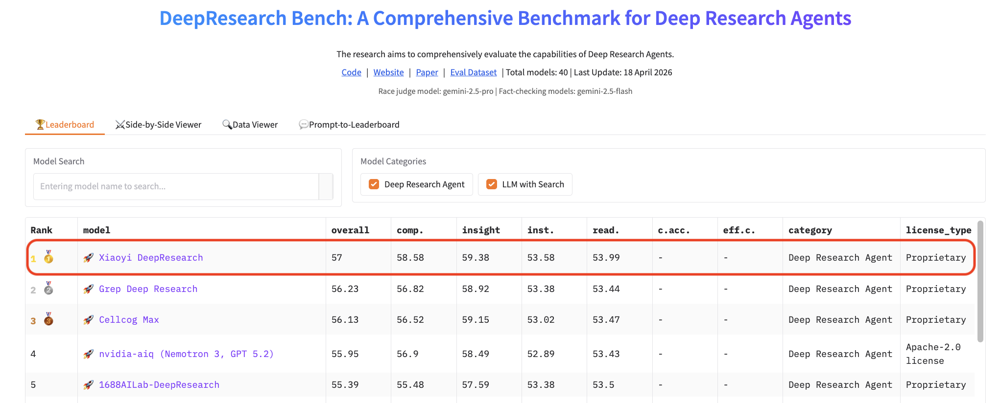
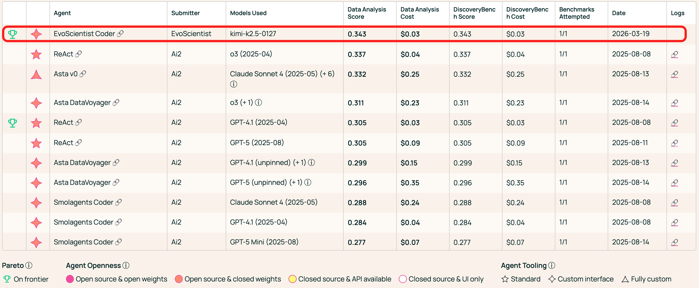

<div align="center">
    <picture>
      <source media="(prefers-color-scheme: light)" srcset="https://raw.githubusercontent.com/EvoScientist/EvoScientist/main/.github/assets/logo-dark.svg">
      <source media="(prefers-color-scheme: dark)" srcset="https://raw.githubusercontent.com/EvoScientist/EvoScientist/main/.github/assets/logo-light.svg">
      
    </picture>
</div>

<div align="center">
<a href="https://pypi.org/project/EvoScientist/"><picture>
  <source media="(prefers-color-scheme: light)" srcset="https://raw.githubusercontent.com/EvoScientist/EvoScientist/main/.github/assets/badge-pypi-light.svg">
  <source media="(prefers-color-scheme: dark)" srcset="https://raw.githubusercontent.com/EvoScientist/EvoScientist/main/.github/assets/badge-pypi-dark.svg">
  
</picture></a><a href="https://EvoScientist.github.io/"><picture>
  <source media="(prefers-color-scheme: light)" srcset="https://raw.githubusercontent.com/EvoScientist/EvoScientist/main/.github/assets/badge-website-light.svg">
  <source media="(prefers-color-scheme: dark)" srcset="https://raw.githubusercontent.com/EvoScientist/EvoScientist/main/.github/assets/badge-website-dark.svg">
  
</picture></a><a href="https://github.com/langchain-ai/deepagents"><picture>
  <source media="(prefers-color-scheme: light)" srcset="https://raw.githubusercontent.com/EvoScientist/EvoScientist/main/.github/assets/badge-framework-light.svg">
  <source media="(prefers-color-scheme: dark)" srcset="https://raw.githubusercontent.com/EvoScientist/EvoScientist/main/.github/assets/badge-framework-dark.svg">
  
</picture></a><a href="https://github.com/EvoScientist/EvoScientist/blob/main/LICENSE"><picture>
  <source media="(prefers-color-scheme: light)" srcset="https://raw.githubusercontent.com/EvoScientist/EvoScientist/main/.github/assets/badge-license-light.svg">
  <source media="(prefers-color-scheme: dark)" srcset="https://raw.githubusercontent.com/EvoScientist/EvoScientist/main/.github/assets/badge-license-dark.svg">
  
</picture></a>
</div>

---

<div align="center">
<a href="https://github.com/EvoScientist/EvoScientist"></a>
</div>

<div align="center">

**[English](./README.md) | 简体中文**

</div>

**EvoScientist 是一个开源的自我进化 AI 科研伙伴。** 只需给出研究问题，它便能自主制定实验计划、检索文献、编写与调试代码、分析数据并撰写报告，同时在跨会话记忆与技能积累中持续成长。相比步步紧盯的人在回路（Human-in-the-Loop），它采用**人在环上（Human-on-the-Loop）**模式——由你把握方向、审批关键操作，并用目标和验收标准把关结果。

<h3>🏆 荣誉与认可</h3>

<table>
  <tr>
    <td align="center" valign="top" width="33%">
      
      <br />
      <sub><b>最佳论文与评审奖</b></sub>
    </td>
    <td align="center" valign="top" width="33%">
      
      <br />
      <sub><b>AI 生成最佳论文</b></sub>
    </td>
    <td align="center" valign="top" width="33%">
      
      <br />
      <sub><b>DeepResearch Bench II 第一名</b></sub>
    </td>
  </tr>
</table>

<br />

<table>
  <tr>
    <td align="center" valign="top" width="33%">
      
      <br />
      <sub><b>DeepResearch Bench 第一名</b></sub>
    </td>
    <td align="center" valign="top" width="33%">
      
      <br />
      <sub><b>AstaBench 代码与执行榜第一名</b></sub>
    </td>
    <td align="center" valign="top" width="33%">
      
      <br />
      <sub><b>AstaBench 数据分析榜第一名</b></sub>
    </td>
  </tr>
</table>

<h3>⚡ 统一后端，多端协作</h3>

<table>
  <tr>
    <th><p align="center">🌐 桌面端与 WebUI</p></th>
  </tr>
  <tr>
    <td align="center">
      <video src="https://github.com/user-attachments/assets/b977f2d5-488a-428d-9c02-b6b27c1521f8" autoplay loop muted playsinline width="100%">
        <a href="https://github.com/user-attachments/assets/b977f2d5-488a-428d-9c02-b6b27c1521f8">观看 WebUI 演示</a>
      </video>
    </td>
  </tr>
</table>

<table>
  <tr>
    <th width="75%"><p align="center">🖥️ CLI / TUI</p></th>
    <th width="25%"><p align="center">📱 移动端与即时通讯</p></th>
  </tr>
  <tr>
    <td align="center">
      <video src="https://github.com/user-attachments/assets/a40ba429-bb07-4663-b5b1-77aed1a833b9" autoplay loop muted playsinline width="100%">
        <a href="https://github.com/user-attachments/assets/a40ba429-bb07-4663-b5b1-77aed1a833b9">观看终端演示</a>
      </video>
    </td>
    <td align="center">
      <video src="https://github.com/user-attachments/assets/4919e6f4-e434-46c9-98c7-35d7482868a6" width="100%" autoplay loop muted playsinline>
        <a href="https://github.com/user-attachments/assets/4919e6f4-e434-46c9-98c7-35d7482868a6">观看移动端演示</a>
      </video>
    </td>
  </tr>
</table>

## ✨ 核心特性

- **多智能体科研团队：** 内置 6 个专职子智能体（规划、文献调研、编码、调试、数据分析、论文写作），并支持按需调用专家技能（`/expert`）。
- **自我进化记忆与 AutoSkills：** 每轮自动提炼经验并构建关联知识图谱，定期从记忆中生成可复用技能供你审核（`/autoskills`）。
- **目标驱动与验收评分：** 用 `/goal` 或 `--rubric` 设定验收清单，由独立评审模型自动检查产物并驱动修订。
- **多端统一体验：** 支持桌面客户端、浏览器 WebUI（`--ui webui`）、Textual TUI、经典 CLI、10 大即时通讯渠道（`EvoSci serve`）、定时任务（`/schedule`）以及无头 `stream-json` 流。
- **多模型与订阅直连：** 支持 Anthropic、OpenAI、Google、OpenRouter、DeepSeek、MiniMax、NVIDIA、Ollama 与自定义 OpenAI/Anthropic 接口，也支持 Claude Pro/Max 与 ChatGPT Plus/Pro 订阅登录。
- **MCP 与技能生态：** 一条命令接入 MCP 服务器（`EvoSci mcp add`），或通过 `/evoskills` 直接安装 [**EvoSkills**](https://github.com/EvoScientist/EvoSkills) 科研全流程技能。

## 🔥 动态

- **[2026-11-14]** 🍎 **macOS 桌面端**（Apple Silicon，已签名公证）发布：[**立即下载**](https://github.com/EvoScientist/EvoScientist-WebUI/releases/latest/download/EvoScientist-arm64.dmg)
- **[2026-11-03]** 🖥️ **Windows 桌面端**发布：[**立即下载**](https://github.com/EvoScientist/EvoScientist-WebUI/releases/latest/download/EvoScientist-Setup.exe)
- **[2026-06-03]** 🥈 [ResearchClawBench](https://internscience.github.io/ResearchClawBench-Home/) 总榜第二（`GPT-5.4` 阵营第一）
- **[2026-04-13–18]** 🥇 登顶 [DeepResearch Bench](https://huggingface.co/spaces/muset-ai/DeepResearch-Bench-Leaderboard) 与 [DeepResearch Bench II](https://agentresearchlab.com/benchmarks/deepresearch-bench-ii/index.html#leaderboard)
- **[2026-03-25–26]** 🥇 登顶 [AstaBench 代码与执行](https://allenai-asta-bench-leaderboard.hf.space/code-execution) 与 [数据分析](https://allenai-asta-bench-leaderboard.hf.space/data-analysis) 榜
- **[2026-03-11–13]** 🚀 EvoScientist 正式开源并发布[技术报告](https://arxiv.org/abs/2603.08127)
- **[2025-11-24]** 🏆 [ICAIS 2025](https://icais.ai/) 投稿 6/6 全中，荣获最佳论文与 AI 评审奖

<details>
<summary>📦 近期版本更新（v0.4.x）— 完整记录见 <a href="https://github.com/EvoScientist/EvoScientist/releases">GitHub Releases</a></summary>

- **[v0.4.4](https://github.com/EvoScientist/EvoScientist/releases/tag/v0.4.4)**（2026-11-20）— 新增 GPT-6.2 Sol/Astra、Gemini 4 Neon、HY4 Flash、Qwen 4 Max；新增 `EvoSci login chatgpt`；自定义 OpenAI 接口自动拉取 `/models`；更严格的 Shell 沙箱；升级至 `deepagents 0.7.41`。
- **[v0.4.3](https://github.com/EvoScientist/EvoScientist/releases/tag/v0.4.3)**（2026-11-14）— 新增 Claude Fable 5.2、Gemini 4 Carbon/Hydrogen；新增 `EvoSci workspace move`；`EvoSci server` 统一托管后台服务与 `ccproxy`；支持在对话中回传媒体文件。
- **[v0.4.2](https://github.com/EvoScientist/EvoScientist/releases/tag/v0.4.2)**（2026-11-06）— 统一 Claude/OpenAI/OpenRouter/DeepSeek 的 `reasoning_effort`（默认 `high`）；新增腾讯 HY4；命令失败与后台进程状态提示更清晰。
- **[v0.4.1](https://github.com/EvoScientist/EvoScientist/releases/tag/v0.4.1)**（2026-11-03）— WebUI 与桌面端共享同一后台服务（WebUI 0.5）；取消任务同步中止 Shell 命令。
- **[v0.4.0](https://github.com/EvoScientist/EvoScientist/releases/tag/v0.4.0)**（2026-10-31）— 全项目共享单后台服务（`EvoSci server stop`）；新增 GPT-6.1 Terra；强化沙箱与 `EvoSci update` 安全性。

</details>

---

## 📦 安装

### 桌面客户端

<p align="center">
<a href="https://github.com/EvoScientist/EvoScientist-WebUI/releases/latest/download/EvoScientist-Setup.exe"><picture>
  <source media="(prefers-color-scheme: light)" srcset="https://raw.githubusercontent.com/EvoScientist/EvoScientist/main/.github/assets/button-download-windows-light.svg">
  <source media="(prefers-color-scheme: dark)" srcset="https://raw.githubusercontent.com/EvoScientist/EvoScientist/main/.github/assets/button-download-windows-dark.svg">
  
</picture></a>&nbsp;<a href="https://github.com/EvoScientist/EvoScientist-WebUI/releases/latest/download/EvoScientist-arm64.dmg"><picture>
  <source media="(prefers-color-scheme: light)" srcset="https://raw.githubusercontent.com/EvoScientist/EvoScientist/main/.github/assets/button-download-macos-light.svg">
  <source media="(prefers-color-scheme: dark)" srcset="https://raw.githubusercontent.com/EvoScientist/EvoScientist/main/.github/assets/button-download-macos-dark.svg">
  
</picture></a>
</p>

> [!NOTE]
> macOS 版仅支持 Apple Silicon（macOS 13+，已签名公证）。Windows 安装包暂未签名，遇到 SmartScreen 提示时点击**更多信息 → 仍要运行**即可。

### 一键命令行安装（推荐）

无需预先安装 Python、`uv`、Node.js 或 Git，支持 macOS（Apple Silicon）、Linux、WSL2 与原生 Windows：

```bash
# macOS / Linux / WSL2
curl -fsSL https://evoscientist.ai/install.sh | bash

# 中国大陆镜像（--cn）
curl -fsSL https://cdn.jsdelivr.net/gh/EvoScientist/EvoScientist@main/scripts/install.sh | bash -s -- --cn
```

```powershell
# Windows (PowerShell)
irm https://evoscientist.ai/install.ps1 | iex

# 中国大陆镜像（-Cn）
& ([scriptblock]::Create((irm https://cdn.jsdelivr.net/gh/EvoScientist/EvoScientist@main/scripts/install.ps1))) -Cn
```

安装完成后**重新打开终端**，执行 `EvoSci onboard`，然后运行 `EvoSci`。后续升级只需运行 `EvoSci update`。代理、企业 TLS 证书与卸载步骤见[安装指南](docs/guides/install.md)。

<details>
<summary>其他安装方式（<code>uv</code> / <code>pip</code> / Docker / 源码开发）</summary>

```bash
# uv / pip（需 Python 3.11–3.13）
uv tool install EvoScientist
uv pip install 'EvoScientist[telegram,feishu,wechat]'   # 按需安装渠道依赖，或 all-channels

# 源码开发
git clone https://github.com/EvoScientist/EvoScientist.git && cd EvoScientist
uv sync --dev --extra all-channels
uv run pre-commit install

# Docker（将命令沙箱限制在挂载目录内）
mkdir -p workspace
docker run -it --rm --env-file .env \
  -v "$(pwd)/workspace:/workspace" \
  -v evosci-data:/home/evosci/.evoscientist \
  ghcr.io/evoscientist/evoscientist:latest
```

</details>

---

## 🔑 配置与快速开始

首次运行交互式向导，完成服务商、模型、API Key（或 Claude/ChatGPT 订阅登录）与工作区配置：

```bash
EvoSci onboard
EvoSci
```


### 常用命令

```bash
EvoSci                                        # 交互式 TUI（默认）
EvoSci --ui webui                             # 浏览器 WebUI（http://localhost:4716）
EvoSci --ui cli                               # 经典 CLI（便于终端原生复制）
EvoSci -p "分析 results.csv"                  # 单次运行（长提示可用 --prompt-file）
EvoSci --workdir /path/to/project             # 在指定项目目录启动
EvoSci -m run                                 # 独立隔离会话目录
EvoSci serve                                  # 无头模式（仅运行即时通讯渠道）
EvoSci deploy                                 # 独立 LangGraph 后端（程序集成可加 --json）
EvoSci -p "query" --output-format stream-json # JSONL 事件流（见 docs/guides/stream-json.md）
EvoSci -p "query" --rubric @criteria.md       # 按验收清单自动评分修订（见 docs/guides/rubric.md）
```

> [!WARNING]
> 后台服务（端口 `6174`）和 WebUI（端口 `4716`）默认仅监听 `127.0.0.1`。请勿在不可信网络中直接暴露 `--host 0.0.0.0`，远程访问优先使用 SSH 端口转发：`ssh -L 6174:localhost:6174 -L 4716:localhost:4716 <host>`。详见 [安全策略](SECURITY.md)。

---

## ⏰ 定时任务、MCP 与消息渠道

- **定时任务（`/schedule`）：** 支持 Cron 表达式和自然语言调度，可选 `--rubric` 自动验收结果。
- **MCP 工具接入：** 一行命令添加外部 MCP 服务 — `EvoSci mcp add sequential-thinking npx -- -y @modelcontextprotocol/server-sequential-thinking`（见 [MCP 指南](EvoScientist/mcp/README.md)）。
- **消息渠道：** 支持 Telegram、Discord、Slack、飞书、企业微信/公众号、钉钉、QQ、Signal、邮件和 iMessage — `EvoSci channel setup telegram`（见 [渠道指南](EvoScientist/channels/README.md)）。

## 📚 完整文档

查看 **[docs/README.md](docs/README.md)** 获取全部指南、配方与示例（安装、自定义接口、订阅登录、`/goal`、`/rubric`、模型重试、`stream-json` 与文献综述示例）。

## 🤝 参与贡献与社区

提 PR 前请先阅读 **[CONTRIBUTING.md](CONTRIBUTING.md)**（使用 AI 编程助手请先阅读 **[AGENTS.md](AGENTS.md)**）。垂直科研工作流推荐贡献到 [**EvoSkills**](https://github.com/EvoScientist/EvoSkills)。


- **[Discord](https://discord.gg/AZ9ZMXkunY)** — 实时交流、问题反馈与协作开发。
- **[微信交流群](https://github.com/EvoScientist/EvoScientist/blob/main/.github/assets/cn_info.md)** — 加入中文科研社区：

  

## 🌍 团队与致谢

本项目基于 [**LangChain**](https://github.com/langchain-ai/langchain)、[**DeepAgents**](https://github.com/langchain-ai/deepagents) 与 [**jiuwenswarm**](https://github.com/openJiuwen-ai/jiuwenswarm) 构建。

#### 核心贡献者

<table>
  <tbody>
    <tr>
      <td align="center">
        <a href="https://x-izhang.github.io/">
          
          <br />
          <sub><b>Xi Zhang</b></sub>
        </a>
      </td>
      <td align="center">
        <a href="https://youganglyu.github.io/">
          
          <br />
          <sub><b>Yougang Lyu</b></sub>
        </a>
      </td>
      <td align="center">
        <a href="https://din0s.me/">
          
          <br />
          <sub><b>Dinos Papakostas</b></sub>
        </a>
      </td>
      <td align="center">
        <a href="https://www.linkedin.com/in/qianru-meng-410311100/">
          
          <br />
          <sub><b>Qianru Meng</b></sub>
        </a>
      </td>
      <td align="center">
        <a href="https://muxincg2004.github.io/">
          
          <br />
          <sub><b>Ziheng Zhang</b></sub>
        </a>
      </td>
      <td align="center">
        <a href="https://xiaohuiyan.github.io/">
          
          <br />
          <sub><b>Xiaohui Yan</b></sub>
        </a>
      </td>
    </tr>
  </tbody>
</table>

#### 贡献者

Jakub Kaliski, Jakub Filipiuk, Yuyue Zhao, Jan Piotrowski, Wiktor Cupiał, Xinhao Yi, Shuyu Guo, Andreas Sauter, Wenxiang Hu, Jacopo Urbani, Zaiqiao Meng, Jun Luo, Lun Zhou

> 感谢 <a href="https://xiaoyi.huawei.com/chat/research"></a> [*小艺深度研究（Xiaoyi DeepResearch）*](https://xiaoyi.huawei.com/chat/research) 团队与广大开源社区的贡献。

联系我们：[**EvoScientist.ai@gmail.com**](mailto:evoscientist.ai@gmail.com)

<a href="https://github.com/EvoScientist/EvoScientist/graphs/contributors">
  
</a>

### 📈 Star 趋势

[](https://www.star-history.com/?repos=EvoScientist%2FEvoScientist&type=date&legend=top-left)

## 📝 引用与许可证

采用 **Apache 2.0** 协议开源（[LICENSE](./LICENSE)）。如果本项目对你的研究有帮助，欢迎引用：

```bibtex
@article{evoscientist2026,
  title={EvoScientist: Towards Multi-Agent Evolving AI Scientists for End-to-End Scientific Discovery},
  author={Yougang Lyu and Xi Zhang and Xinhao Yi and Yuyue Zhao and Shuyu Guo and Wenxiang Hu and Jan Piotrowski and Jakub Kaliski and Jacopo Urbani and Zaiqiao Meng and Lun Zhou and Xiaohui Yan},
  journal={arXiv preprint arXiv:2603.08127},
  year={2026}
}
```
