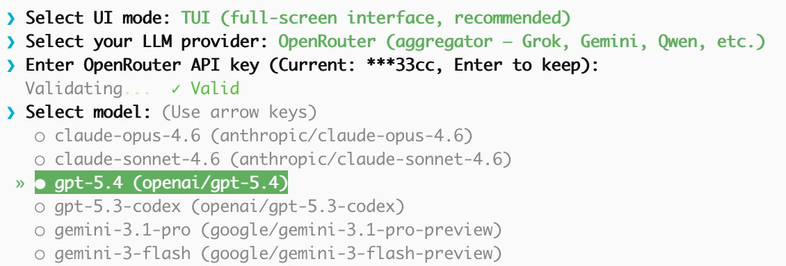
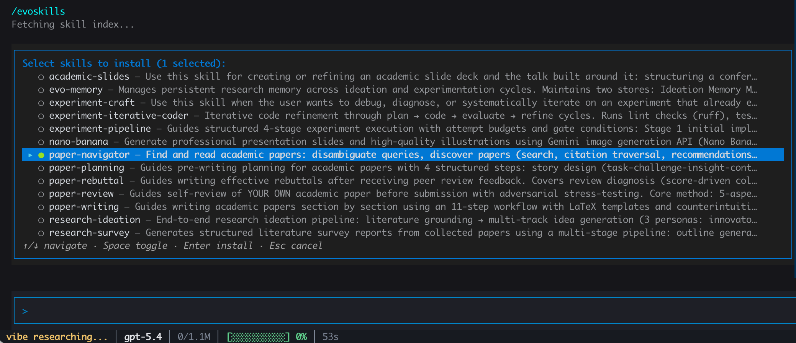
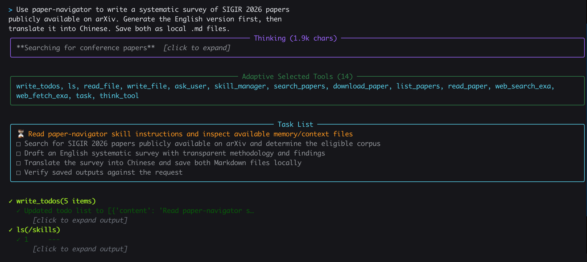

# Example: Systematic Literature Survey

Use EvoScientist with the [`paper-navigator`](https://github.com/EvoScientist/EvoSkills/tree/main#-paper-navigator--academic-paper-discovery--reading) skill to turn a topic or venue scope into a bilingual, conference-grade literature survey with arXiv citations.

## Sample Output

This worked run surveyed **68 arXiv-public SIGIR 2026 papers** across 10 sections (abstract, thematic map, four method fronts, evaluation/fairness, cross-theme trends, open questions, conclusion, and references):

- **English:** [`SIGIR2026_public_arxiv_systematic_survey_en.md`](SIGIR2026_public_arxiv_systematic_survey_en.md)
- **中文:** [`SIGIR2026_public_arxiv_systematic_survey_zh.md`](SIGIR2026_public_arxiv_systematic_survey_zh.md)

## How It Works

Given a topic/venue, an LLM provider, and `paper-navigator`, EvoScientist:

1. Expands the topic into 4–6 search angles and terminology variants.
2. Discovers papers via arXiv, Semantic Scholar, and citation traversal.
3. Deduplicates and groups them into a thematic taxonomy.
4. Reads each paper for a structured TL;DR, key contribution, and limitation.
5. Drafts the survey section by section with inline numbered citations.
6. Writes the English Markdown file first, then translates it into Chinese—both saved locally with arXiv links.

## Run It Yourself

Any strong model and provider works.

1. **Install and configure a provider:**
   ```bash
   uv tool install EvoScientist
   EvoSci onboard
   ```
   

2. **Install `paper-navigator` inside an `EvoSci` session:**
   ```text
   /evoskills
   ```
   

3. **Paste the prompt:**
   ```text
   Use paper-navigator to write a systematic survey of SIGIR 2026 papers
   publicly available on arXiv. Generate the English version first, then
   translate it into Chinese. Save both as local .md files.
   ```
   

Both Markdown files are saved in your current workspace.

## Adapting to Your Own Topic

- **Different venue or year:** Swap the conference/year in the prompt.
- **One language only:** Drop the Chinese translation sentence.
- **Narrower scope:** Add a sub-topic constraint (e.g. *"focus only on retrieval-augmented reasoning"*).
- **Smaller paper budget:** Cap the paper count (e.g. *"at most 30 papers"*).
